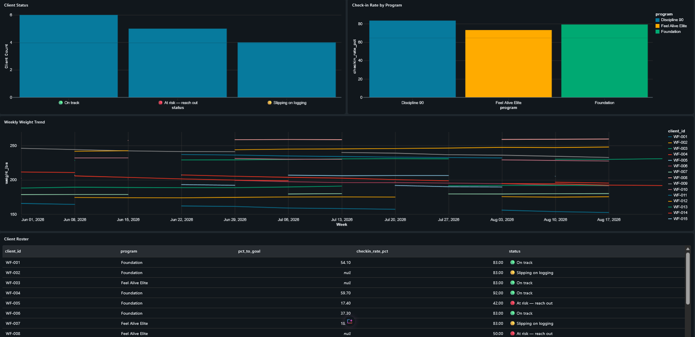

# WizFit Client Progress Pipeline

An end-to-end data pipeline built on **Databricks** with **PySpark** and **Delta Lake**, using a
bronze → silver → gold (medallion) architecture to turn messy online-coaching data into
business-ready tables and a dashboard.

## The problem
I run WizFit, a 1-on-1 online fitness coaching business. Client data comes in from weekly
check-in forms, nutrition logs, and workout logs, and it's messy: mixed date formats, weights
entered in the wrong unit, duplicate submissions, typos in IDs. I wanted one reliable place to
answer:

- Which clients are on track toward their goal?
- Who is falling off and needs outreach *before* they quit?
- Are clients actually getting stronger?

Clients who stop checking in are the clients who quit. Catching drop-off early, and knowing which
program keeps people most consistent, directly protects revenue in a coaching business.

## Architecture

```
CSV files (Unity Catalog Volume)
        │
   🥉 BRONZE   raw data landed as strings + ingest timestamp + source file
        │
   🥈 SILVER   cleaned, typed, deduplicated, validated
        │
   🥇 GOLD     gold_client_progress · gold_weekly_trends · gold_strength_progress
        │
   📊 Databricks Dashboard
```

## Data quality issues handled

| Issue in raw data | How the pipeline fixes it |
|---|---|
| Client IDs with spaces / lowercase | Trimmed and upper-cased |
| Two date formats (`2026-06-04`, `06/04/2026`) | Pattern-matched to the right parser |
| Weights entered in kg instead of lbs | Detected (< 50% of start weight) and converted |
| Duplicate check-in submissions | Deduplicated on client + date |
| Negative calorie entries | Filtered out and counted |
| Inconsistent exercise names (`DEADLIFT`) | Normalized to title case |

A data quality report prints counts for each issue on every run.

## Gold tables

- **gold_client_progress**: one row per client: weight change, % to goal, check-in rate,
  logging rate, avg protein, and a status flag (🟢 on track / 🟡 slipping / 🔴 at risk)
- **gold_weekly_trends**: weekly weight and training volume per client, built for charting
- **gold_strength_progress**: top load per exercise, first session vs most recent session

## Tech stack
Databricks Free Edition · PySpark · Spark SQL · Delta Lake · Unity Catalog Volumes · Databricks Dashboards

## How to run it
1. Sign up for Databricks Free Edition.
2. Create a Volume: Catalog → `workspace` → `default` → Create → Volume → name it `wizfit_raw`.
3. Upload the 4 CSVs from `/data` into the Volume.
4. Import `wizfit_pipeline.py` (Workspace → Import) and click **Run all**.

## Results

**Data quality (per run)**

| Check | Rows |
|---|---|
| Duplicate check-ins removed | 7 |
| kg weights converted to lbs | 12 |
| Blank weights excluded | 5 |
| Negative calorie entries removed | 28 |
| Unparsed dates | 0 (both formats handled) |

**Business insights**
- Flagged **5 of 15 clients as at-risk** and **4 as slipping on logging**, giving a ready-made weekly outreach list
- **Discipline 90** had the highest average check-in rate (~84%), vs Foundation (~79%) and Feel Alive Elite (~73%)
- Strength table tracks every client's progress on each lift from first to most recent session



## Bugs I found and fixed
1. **Misleading "% to goal":** one client's goal was 0.4 lbs from their start weight, so tiny changes
   showed as 325% to goal. Fix: only calculate % to goal when the goal is a change of 5+ lbs;
   otherwise leave it null instead of showing a misleading number.
2. **Nulls in strength progress:** clients rotate exercises, so many lifts didn't appear in a
   client's first or last calendar week. Fix: compare each lift's first session to its last session
   using a window function partitioned by client and exercise.

## What I'd add next
- Schedule as a weekly Lakeflow Job with alerts when a client turns 🔴
- Rebuild the silver layer as a Lakeflow Declarative Pipeline with data-quality expectations
- Connect directly to the check-in form instead of CSV exports

## Note on the data
The data in `/data` is synthetic sample data modeled on my real coaching workflow. No real
client information is included.
